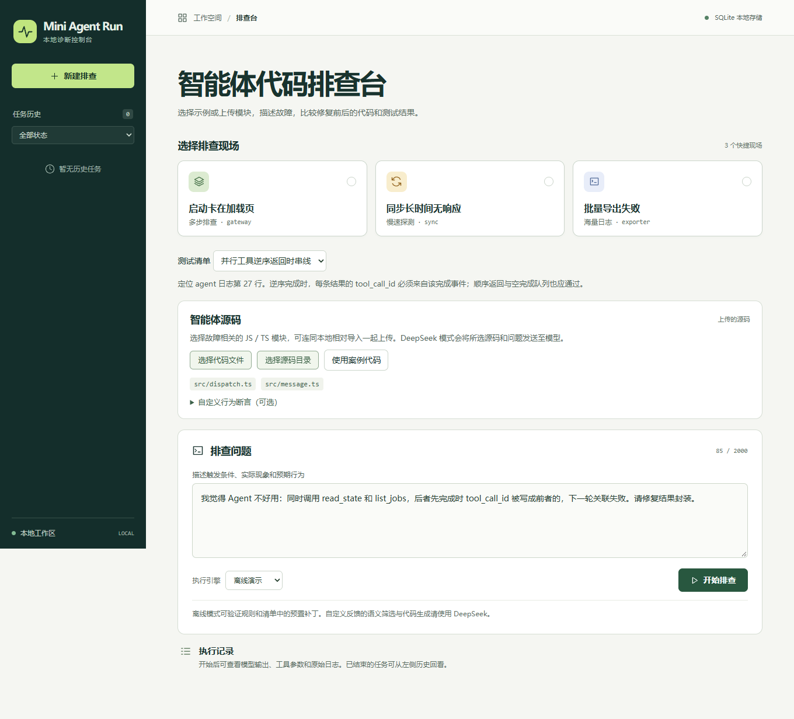
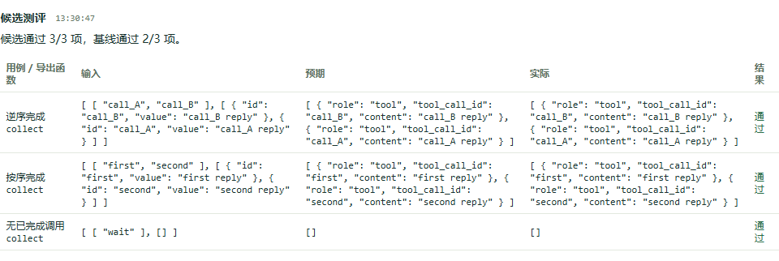

# 操作运行手册

## 一、启动桌面交付版

1. 使用桌面上已展开的项目，或将 ZIP 完整解压。打开里面含 `start.cmd`、`package.json`、`runtime` 和 `dist` 的目录。
2. 在 PowerShell 输入 `node -v`，要求 Node.js 22.18 或以上。若未安装，安装后重新打开终端。[Node.js 官网](https://nodejs.org/en/download)
3. 双击 `start.cmd`，保留黑色终端窗口，浏览器访问 [本地排查台](http://127.0.0.1:4318)。初次未配置 .env 时，可直接体验离线案例。
4. 默认打开「Agent 故障诊断」。从「全部诊断案例」任选 CASE-001 至 CASE-008，或上传自己的模块。在「用户反馈 / GitHub Issue」填写问题后开始诊断。逐例需要核对的证据、如何运行单文件及测试修复的方法见[八例操作与验收手册](Doctor诊断与八例验收.md)。



## 二、从上传到回滚，实际做一遍

在新建页切换到「代码修复与回滚」，以下截图和步骤都对应这个入口。

**准备文件。** 包内 `examples/upload-agent` 是一个自实现的智能体工具结果模块，包含 `src/dispatch.ts`、`src/message.ts` 和 `checks.json`。目录导入会保留根目录下面的层次。

1. 在「测试清单」选择「并行工具逆序返回时串线」，引擎选「离线演示」。
2. 点「选择源码目录」并选中整个 **upload-agent** 文件夹。页面应列出 `src/dispatch.ts` 和 `src/message.ts`。也可以上传单个文件；单文件选择使用文件名，断言的 file 字段需与界面显示的路径一致。
3. 展开「自定义行为断言」，点「读取断言 JSON」，选择 `examples/upload-agent/checks.json`。这里分别验证逆序完成、顺序完成和零个已完成调用。
4. 点击「开始排查」。虽然问题以“不好用”开头，后半句给出了工具名称、完成次序和错误 ID，规则应放行。查看现场中的工具调用及日志第 27 行，再看「修复过程与测评」。
5. 对照「基线结果」和「候选测评」。原始代码在逆序时错配 ID，修复改为从完成事件取 ID。观察到基线 2/3、候选 3/3，项目将出现原始导入与已验证修复两个快照。



6. 在「源码版本」选择已验证修复，展开「查看所选版本代码」，切换文件，点击「下载所选源码 ZIP」。解压下载包可检查实际修改的文件，原文件上传时所在的目录不受写入。
7. 选择「原始导入」，点击「回滚到所选版本」。活动版本变为一条新的回滚快照。展开代码可看到原来的 `pending[index]`，已验证修复也仍在列表中。
8. 在当前详情按 F5，再关闭服务并从同一目录重启，打开左侧历史。代码、模型输出、日志、测试结果和回滚记录应能再次查看。

## 三、使用真实模型调查自己的项目

在项目根目录打开或创建配置文件。

```powershell
notepad .env
```

将题面提供的测试凭证或自己的有效凭证填在 `DEEPSEEK_API_KEY=` 后面。默认模型名为 `deepseek-flash`。保存后在终端按 Ctrl+C 停止旧进程，再双击 start.cmd 并刷新。只要切换至「DeepSeek」，就可提交自定义问题，模型也会结合上传源码进行语义筛选与改码。

对 pi Agent 或自己的 Agent，选择故障相关的导出函数及其本地依赖。例如针对并行工具串线，可以选中 tool-result 构造器和调度器模块，输入「同时调用 A、B，B 先完成时被写入 A 的 tool_call_id；期望结果始终携带实际完成调用的 ID」。目录上传会跳过 node_modules、dist、build、coverage 和隐藏目录。

**自行提供验证方法**时，断言应指向上传后的实际相对路径和导出名。下面的断言适用于包内双文件示例。多个断言放入同一数组，可粘贴或存为 JSON 导入。

```json
[
  {
    "name": "空完成队列",
    "file": "src/dispatch.ts",
    "fn": "collect",
    "args": [["call_A"], []],
    "expected": []
  }
]
```

独立断言最好同时覆盖会失败的输入和需要保留的正常行为。若当前版本已满足全部断言，系统会记录“本次未复现代码故障”。留空时，真实模型会根据用户预期先拟定断言，再测试基线。展开断言检查业务假设；缺少可验证预期时，可补充问题和断言重新提交。

**已有项目继续排查。** 在历史任务详情点击「基于当前版本继续排查」，编辑问题后开始。该操作以启动时的活动版本为基线。如果要换另一套源码，点击「切换源码」。单纯重跑同一问题可直接点「重新执行」。

## 四、检查错误补丁能否被拦住

选择「候选遗漏等值边界」，使用离线演示。确认源码区标注为「案例自带源码」；如仍显示上次上传的文件，点「使用案例代码」。这次演示故意用 `freeMiB > requiredMiB` 作为候选。对 8/64 的处理正确，但 64/64 原本能写入，修改后被错误拒绝。任务应失败，详情显示断言、实际值和候选差异，源码版本列表应只有原始导入。

「主观体验反馈」和「无关数学请求」可验收过滤；「同步在 87% 耗尽重试」可在探针等待时验收停止、重试；「导出在归档阶段耗尽磁盘」可验收大日志搜索、翻页与定位。各项预期见 [案例与验证方法](测试案例与验收.md)。

## 五、终端命令与常见现象

| 操作 | 在项目根目录执行 |
| --- | --- |
| 启动服务 | Windows 用 `npm.cmd start`；macOS / Linux 用 `npm start` |
| 运行全部回归测试 | `npm.cmd test`，只需 Node |
| 修改源码并重建 | `npm.cmd ci` → `npm.cmd run check` → `npm.cmd run build`。首次安装开发依赖需联网 |
| 查看交付历史 | `git log --oneline` |
| 停止服务、备份数据 | Ctrl+C 结束服务，再复制整个 `data` 目录 |

| 遇到的现象 | 可检查的地方 |
| --- | --- |
| 找不到 node、无法识别 .ts 或 node:sqlite | 检查 Node 版本，必要时升级后重新打开终端 |
| 4318 已被占用 | 在 .env 修改 PORT，重启后用终端打印的新地址访问 |
| 真实模式鉴权失败、余额不足或限流 | 核对密钥、账户和服务状态。模型失败会保留历史，可修正后重试 |
| 上传时提示重复路径或断言指向未知文件 | 改用目录上传，核对页面显示的相对路径和断言的 file 字段 |
| 缺少导出函数、外部模块或返回 Promise | 提供其本地依赖，或抽取可独立验证的同步模块。项目级数据库 / 网络集成需要原项目的测试环境 |
| 提示活动版本已变化 | 另一条任务或回滚更新了项目。重新打开项目并基于最新版本重跑 |
| 想修改已下载项目中的原文件 | 下载所选修复版本的源码 ZIP，先核对差异，再在原仓库合并并运行其集成测试 |
